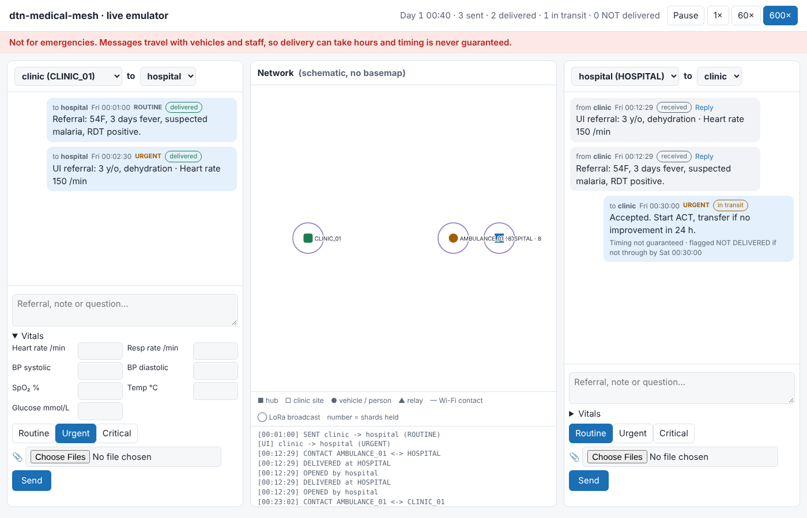

# dtn-medical-mesh

Moves encrypted clinical messages between health sites that have **no internet**, using the vehicles and people already travelling between them. Small nodes on clinic tables, ambulance shelves and street lights swap encrypted pieces of each message whenever they come within radio range, and carry them on. Staff only see a chat-style app: write a referral, attach a photo, and some time later the hospital receives it and can reply.

> **Not for emergencies.** Delivery depends on vehicles and people moving, so it can take hours, and timing is never guaranteed. The app says so on every message.
>
> **Not certified.** The design follows the structure of IEC 62304, ISO 14971, GDPR Art. 9 and HIPAA §164.312 so a future partner can build on it, but no conformity is claimed.



## Try it (no hardware needed)

```bash
uv run dtn-demo rural-clinics
```

Open http://127.0.0.1:8000. The left chat is a clinic laptop and the right is the hospital. Send a referral and watch it travel on the map. Use 600× to speed time up.

Run a scenario headless and get a report:

```bash
uv run python -m simulation.runner stress --seed 1 --quiet --out out
```

## What it guarantees, and how that is checked

**No silent loss.** Every message ends up **Delivered** (signed delivery ACK), or still in transit and recoverable at the origin, or flagged **NOT DELIVERED — use another channel** at the origin. The emulator checks this invariant at the end of every run, and CI runs the stress scenario on five seeds.

Results on seed 1 (`simulation/scenarios/`):

| Scenario | Simulated | Messages | Delivered | NOT DELIVERED (flagged) | Silent losses |
|---|---|---|---|---|---|
| rural-clinics: 4 clinics, vans, ambulance, solar relays | 72 h | 201 | 199 (2 still in transit) | 0 | **0** |
| disaster-response: aid posts, teams on foot, failing relay, lossy links | 24 h | 74 | 68 (6 in transit) | 0 | **0** |
| island-medevac: ferry twice a day, plane every 2 days | 72 h | 48 | 43 (2 in transit) | 3 critical (6 h lifetime) | **0** |
| stress: loss, bit flips, power and clock faults, forger, blackhole, rogue | 12 h | 59 | 59 | 0 | **0** |

## How it works

```
 Clinic laptop ──USB── site node ~~Wi-Fi~~ mules / relays ~~Wi-Fi~~ hub node ──USB── hospital laptop
  encrypt + shard       sign header        carry ciphertext only       verify        decrypt + ACK
                    ◄──────────── LoRa: delivery ACKs, receipts, revocations ────────────►
```

- **Laptops do all clinical crypto.** Content is signed (Ed25519), sealed to the recipient (X25519 + XChaCha20-Poly1305), padded to fixed sizes, and split into Reed-Solomon shards (any *k* of *k + m* rebuild it; more parity for higher priority). No node ever sees plaintext. A test enforces that node code cannot import endpoint crypto.
- **Headers name no patient or endpoint.** Relays route on public service areas. Every endpoint in the destination area tries to decrypt, and only the recipient can.
- **Every hop verifies.** Site nodes sign headers with a key held in a secure element (P-256). Shards carry Merkle proofs. Peers authenticate with short-lived certificates from the hub, which are renewed only when a node docks at a hub and can be revoked mesh-wide.
- **Drive-by friendly.** Nothing waits for a handshake. A node pushes what the peer lacks at once (Bloom-filter summary, then exact lists if the contact lasts), and custody receipts come back whenever they can. Origins keep their copy until the delivery ACK.
- **Routing.** Copy to everyone while a service area is unknown, then PRoPHET once encounters show who reaches it.
- **Time without trust in clocks.** A Hybrid Logical Clock plus carried Bundle Age; nodes without a working RTC keep time on their monotonic clock and learn it from authenticated peers.
- **Durable.** SQLCipher store (key from the secure element), WAL with `synchronous=FULL`, one transaction per shard. A test kills a writer with `SIGKILL` 500 times and checks every committed shard survives.

## Repository

| Path | What |
|---|---|
| `node/` | Sans-IO node core (`NodeCore.handle(event) -> actions`) and wire formats; runs unchanged in the emulator and, later, on a Pi |
| `endpoint/` | Laptop-side crypto, padding, sharding, FHIR-lite messages, delivery status |
| `interface/` | FastAPI app, chat UI and schematic map (plain HTML/JS, works offline) |
| `simulation/` | Discrete-event emulator: mobility, radio (Wi-Fi window, loss, LoRa airtime and duty cycle), power, clock faults, hostile nodes, metrics |
| `validation/` | All tests; `trace_matrix.py` maps requirements to tests |
| `docs/` | Requirements, hazard log, DPIA template, architecture, protocol, third-party software list |
| `PROJECT_SPEC.md`, `IMPLEMENTATION_PLAN.md` | Specification and the step-by-step plan |

## Development

```bash
uv sync
uv run playwright install chromium   # only for the UI tests
uv run ruff check . && uv run mypy . && uv run pytest -q
uv run python validation/trace_matrix.py
```

Real hardware (Raspberry Pi nodes, secure element, RTC, LoRa, UPS) is the next phase; see `IMPLEMENTATION_PLAN.md` H1/H2. Every hardware part already has an interface and a virtual implementation, so drivers slot in without changing the core.

Licensed under Apache 2.0.
