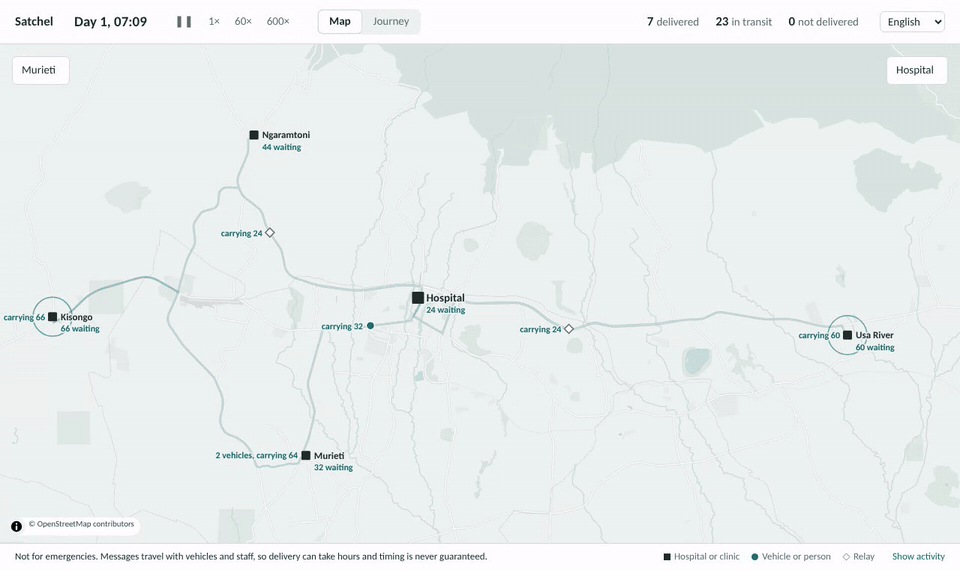
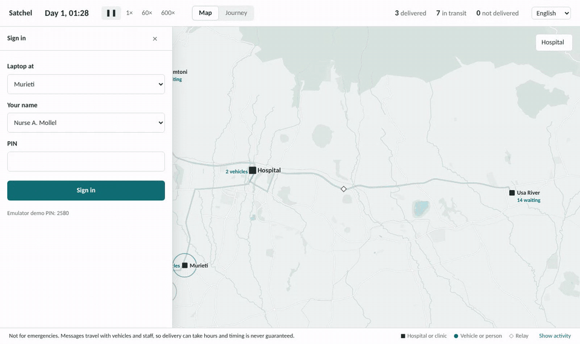
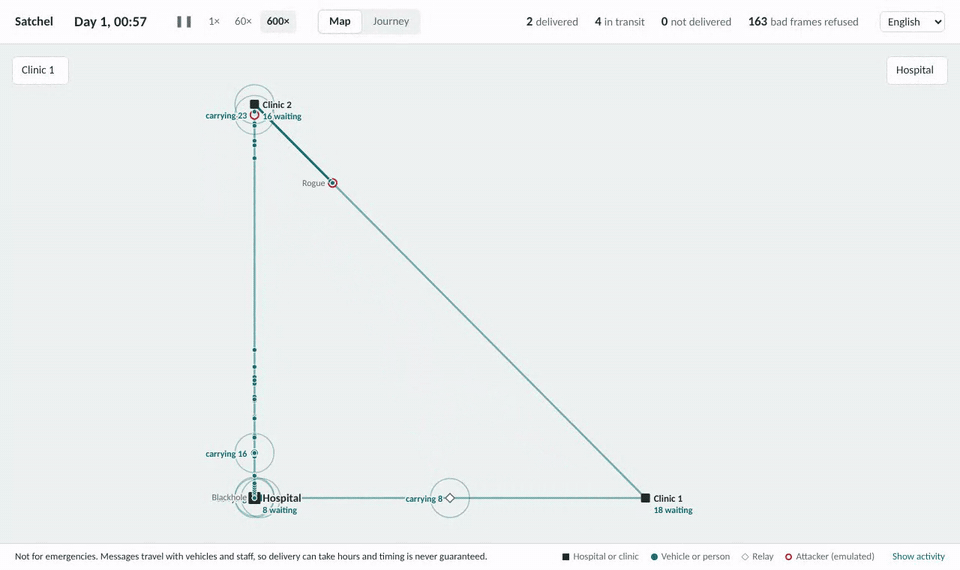
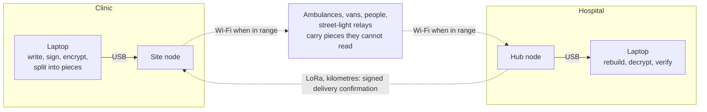

<div align="center">

# Satchel

**Encrypted clinical messages that travel with the vehicles already on the road.**

<sub>dtn-medical-mesh: a delay-tolerant network for health sites with no internet</sub>

[](https://github.com/JFrusher/dtn-medical-mesh/actions/workflows/ci.yml)
[](LICENSE)
[](pyproject.toml)
[](docs/trace_matrix.md)
[](#results)



</div>

A clinic with no signal writes a referral. The next ambulance, van or motorbike that passes picks up encrypted pieces of it without anyone pressing a button, carries them along its route, and hands them on. When enough pieces reach the hospital, the message is rebuilt and opened, and a signed confirmation makes its way back.

Couriers can't read what they carry. No message disappears unnoticed: it is either delivered and confirmed, or the clinic is told plainly to use another channel.

> [!WARNING]
> **Not for emergencies.** Delivery depends on vehicles and people moving, so it can take hours, and timing is never guaranteed. The app says so on every message.

> [!NOTE]
> **Not certified, not deployed.** Everything here runs in an emulator; no hardware or patient data has been used. The design follows the structure of IEC 62304, ISO 14971 and GDPR Article 9 so a clinical partner can build on it, but no conformity is claimed. The Arusha scenario uses real roads and generic site names; no facility is involved or affiliated.

## Try it

```bash
git clone https://github.com/JFrusher/dtn-medical-mesh && cd dtn-medical-mesh
uv run dtn-demo
```

Open http://127.0.0.1:8000. You are looking at a day in the Arusha district, running 60 times faster than real life. Open **Murieti** (top left) to write as the clinic, **Hospital** (top right) to answer, and press **Follow** on any message to see the route its pieces took. Everything, including the street map, works offline.

## See it work

<table>
<tr>
<td width="50%" valign="top">

**A critical referral, followed end to end.** Murieti clinic writes it; the ambulance parked outside takes all 12 pieces; at the hospital 4 are enough to rebuild it. The journey view shows each handover, from the signed custody receipts.

</td>
<td width="50%" valign="top">

**Under attack, still nothing lost.** Lossy radio, flipped bits, power cuts, clocks reset to 1970, a node forging messages, one swallowing everything it is given, and an unregistered device. Thousands of bad frames refused; every message delivered or flagged.

</td>
</tr>
<tr>
<td></td>
<td></td>
</tr>
</table>

## Results

Every scenario is checked for the same invariant at the end of the run: each message is **delivered and confirmed**, **flagged not delivered** at the clinic that sent it, or **still recoverable** from the clinic's own copy. Anything else is a silent loss and fails the run. CI runs the stress scenario on five seeds.

Links follow path loss with shadowing, terrain and building clutter (Arusha), BLE discovery and shared airtime; nodes pay CPU and storage time; vehicles run noisy schedules with night stops and breakdowns. Every parameter and its source is in [`simulation/assumptions.yaml`](simulation/assumptions.yaml).

| Scenario (seed 1) | Simulated | Messages | Delivered | Still in transit | Flagged not delivered | Silent losses |
|---|---|---:|---:|---:|---:|---:|
| **Arusha**, real roads and terrain: hospital, 4 clinics, ambulance, 2 vans, motorbike, a health worker on foot | 24 h | 93 | 82 | 11 | 0 | **0** |
| **Rural clinics**: 4 clinics, solar street-light relays | 72 h | 201 | 199 | 2 | 0 | **0** |
| **Disaster response**: aid posts, teams on foot, lossy links, failing relay | 24 h | 74 | 71 | 3 | 0 | **0** |
| **Island medevac**: ferry twice a day, plane every 2 days | 72 h | 48 | 43 | 2 | 3 | **0** |
| **Stress**: every fault plus three attackers | 12 h | 59 | 54 | 5 | 0 | **0** |

The three flagged on the islands are critical referrals with a 6-hour lifetime and a plane that calls every two days: the system said so, as designed. In Arusha the vans park from 20:00 to 06:00, so messages written at night wait for the morning round.

<details>
<summary><b>Full stress report</b></summary>

```text
$ uv run python -m simulation.runner stress --seed 1 --quiet

Invariant violations: 0 (no silent loss)

Messages sent: 59. DELIVERED: 58, IN_TRANSIT: 1

| Priority | Sent | Delivered % | p50 latency (min) | p90 latency (min) | Max (min) |
|----------|------|-------------|-------------------|-------------------|-----------|
| CRITICAL |    8 |       100.0 |              25.5 |              66.6 |      66.6 |
| ROUTINE  |    9 |       100.0 |              36.6 |              67.2 |      67.2 |
| URGENT   |   42 |        97.6 |              27.0 |              53.5 |     118.2 |

Wi-Fi bytes sent: 4,932,300,194. Frames lost on air: 20368. LoRa frames over duty budget: 6.

Refused by honest nodes: unauthenticated peer 5742, bad signature 5109, corrupt 860,
forged ACK 368, malformed 112, unknown signer 7, forged receipt 2
```

</details>

## How it works



- **The laptop does all the clinical cryptography.** A message is signed by its author (Ed25519), sealed to its recipient (X25519 and XChaCha20-Poly1305), padded to a fixed size, and split into Reed-Solomon pieces: any *k* of *k + m* rebuild it, with more spare pieces for more urgent messages. No node ever sees plaintext, and a test fails the build if node code so much as imports the decryption code.
- **Couriers learn almost nothing.** Headers name no patient and no recipient: messages are routed to a service area, and the recipient finds its own by trying to decrypt.
- **Every hop checks everything.** Pieces carry Merkle proofs and a header signed by the clinic's node with a hardware-held key. Nodes prove who they are with 14-day certificates from the hub, renewed only by visiting it, and revocable mesh-wide.
- **Built for drive-bys.** A van passing a street light may be in range for five seconds. Nothing waits for a handshake: each side pushes what the other lacks, most urgent first, and signed custody receipts follow whenever they can.
- **Learns the roads.** Copies go to everyone until the network has seen enough contacts, then PRoPHET routing sends them towards the nodes that actually reach the destination.
- **Doesn't trust clocks.** A hybrid logical clock plus each message's carried age: a reset clock can neither revive an old message nor kill a fresh one.

## Looking for a pilot partner

Satchel is ready to move from emulator to bench and then to a supervised field pilot that runs *alongside* existing channels. That needs a health service, NGO or ambulance service willing to define a real workflow, provide a data controller and a clinical safety officer, and host a handful of Raspberry Pi nodes.

If that might be you, email **[jacob@frusher.co.uk](mailto:jacob@frusher.co.uk)**.

## For engineers

<details>
<summary><b>One contact, step by step</b></summary>

```mermaid
sequenceDiagram
  participant A as Ambulance
  participant H as Hospital node
  A->>H: Signed summary: Bloom filter of what I hold, my certificate, my clock
  H->>A: Signed summary
  Note over A,H: each checks the other's certificate chain and revocation list
  A->>H: Certificates H lacks, then pieces H lacks, most urgent first
  Note over H: each piece verified alone, stored in one transaction
  H-->>A: Signed custody receipt (batched; may arrive at a later meeting)
  A->>H: Exact list after 2 seconds, catching any Bloom-filter misses
  Note over A,H: the link can drop at any byte: nothing is deleted until receipted or acknowledged
```

Full frame list and deletion rules: [docs/protocol.md](docs/protocol.md).

</details>

<details>
<summary><b>Security model</b></summary>

| If… | Then… |
|---|---|
| a relay is stolen | it holds only ciphertext; its store is encrypted with a key in the secure element; its certificate expires within 14 days and can be revoked now |
| a node forges or alters a piece | the Merkle proof or header signature fails at the next hop and the piece is dropped |
| someone forges a delivery confirmation | it must be signed by a site in the destination area *and* match the signed header, otherwise nothing is purged |
| an unregistered device turns up | its certificate doesn't chain to the hub, so nobody talks to it |
| a node floods the network | it can only inject if it is a certified clinic node, and then only 200 new messages an hour |
| a clock resets to 1970 | the hybrid logical clock never goes backwards, and nodes without a working clock learn time from authenticated peers |

Hazards and their controls: [docs/hazard_log.md](docs/hazard_log.md). Data protection: [docs/dpia_template.md](docs/dpia_template.md).

</details>

<details>
<summary><b>Bugs the emulator caught</b></summary>

Every one was confirmed with evidence before it was fixed, and has a test that fails without the fix.

| Found by | What happened | Fix |
|---|---|---|
| stress, seed 2 | one flipped bit made a header's timestamp negative and crashed a node | range-check every header field; exhaustive bit-flip fuzz test |
| rural clinics | a van rejected delivery confirmations over LoRa from clinics it had never met | share every certificate on contact |
| disaster response | a site whose clock died fell hours behind, and peers stopped trusting it | keep time on the monotonic clock between contacts |
| design review | an unsigned delivery confirmation let any node wipe a message mesh-wide | sign confirmations to the destination area |
| skeleton | a message written during an open contact waited for the next one | push new pieces to peers already connected |

</details>

<details>
<summary><b>Repository</b></summary>

| Path | What |
|---|---|
| [`node/`](node) | The node: a sans-IO state machine (`handle(event) -> actions`) that runs unchanged in the emulator and, next, on a Raspberry Pi |
| [`endpoint/`](endpoint) | Laptop side: encryption, padding, splitting, FHIR-lite messages, delivery status |
| [`interface/`](interface) | The app: FastAPI, chat, street map and journey view (plain HTML/JS, offline) |
| [`simulation/`](simulation) | The emulator: virtual time, roads, radio windows and loss, LoRa airtime, solar and vehicle power, clock faults, attackers, metrics |
| [`validation/`](validation) | 195 tests and the requirement trace matrix |
| [`docs/`](docs) | Requirements, hazard log, DPIA template, architecture, protocol, third-party software |
| [`tools/`](tools) | Rebuild the offline Arusha map and these GIFs |
| [`PROJECT_SPEC.md`](PROJECT_SPEC.md), [`IMPLEMENTATION_PLAN.md`](IMPLEMENTATION_PLAN.md) | The specification and the step-by-step plan |

</details>

<details>
<summary><b>Development</b></summary>

```bash
uv sync
uv run playwright install chromium      # browser tests only
uv run ruff check . && uv run mypy .
uv run python validation/trace_matrix.py # every test, mapped to requirements
uv run python -m simulation.runner arusha --seed 1 --out out
```

Rebuild the offline map and scenario (downloads from Protomaps, npm and OSRM), or the GIFs:

```bash
uv run python tools/build_arusha.py
uv run python tools/record_gifs.py
```

</details>

## What's next

Real hardware: Raspberry Pi nodes with a secure element, battery-backed clock, LoRa radio and UPS. Every one of those already has an interface and an emulated stand-in, so drivers slot in without touching the node logic. See [IMPLEMENTATION_PLAN.md](IMPLEMENTATION_PLAN.md).

## Credits

Map data © [OpenStreetMap](https://www.openstreetmap.org/copyright) contributors (ODbL), via [Protomaps](https://protomaps.com). Map rendering by [MapLibre GL JS](https://maplibre.org), routes by [OSRM](https://project-osrm.org), label glyphs from Noto Sans (SIL OFL). Full list: [docs/soup.md](docs/soup.md).

Licensed under [Apache 2.0](LICENSE).
