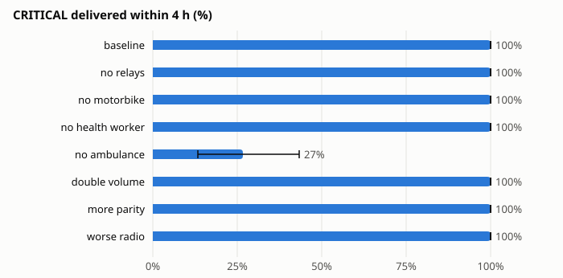
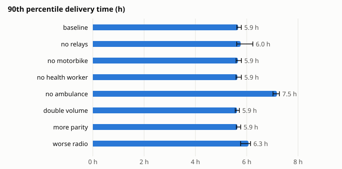

# Arusha pilot sizing

> [!NOTE]
> **Emulated, with estimated volumes.** These results come from the emulator (spec §12) with the
> assumptions listed below. Message volumes, vehicle schedules and radio figures are estimates
> until a clinical partner and the H1 bench replace them. Nothing here is a performance claim.

## What it says

- **The ambulance carries the critical referrals.** With it, every critical referral that had
  4 hours to arrive did so (100 % over 10 simulated days). Without it, only 27 % (13–43 %) did,
  and overall delivery fell from 85 % to 74 % within the day. It is the one vehicle the network
  cannot lose; a second vehicle on the Murieti road is the first thing to add.
- **The relays, the motorbike and the health worker on foot made no measurable difference** in
  this layout: across all messages, delivery within 4 h and the median and 90th-percentile times
  stay inside each other's intervals. (The critical-within-2-hours figures, 93 % with relays and
  100 % without, rest on 30 messages each and their intervals overlap: seed noise, not an effect.)
  The street-light relays sit on roads the vans already drive, and the motorbike and the walker
  serve clinics the ambulance and vans also reach. They are cheap resilience (for a breakdown or
  a skipped round), not capacity.
- **Twice the message volume changed nothing but storage**, which doubled to 3.4 MB on the
  busiest vehicle: far inside a 32 GB card. More parity for critical and urgent messages gave no
  measurable gain here either; the network is limited by when vehicles meet, not by losses.
- **Radio range matters.** With a worse path-loss exponent (3.4, about 60 m instead of 90 m),
  messages delivered within 4 h fell from 78 % (76–80) to 69 % (66–72) and the median time rose
  from 1.7 to 2.2 hours, with intervals that do not overlap. The critical-within-2-hours drop
  (93 % to 77 %) points the same way but its intervals overlap. Measuring real range in H1, and
  mounting antennas well, looks worth more than more relays.
- **About 15 % of each day's messages are still travelling when the day ends**, mostly ones
  written in the evening after the vans have parked (20:00–06:00). None is lost: each is still
  held at its clinic and goes out with the morning round, as the invariant check confirms
  (0 violations in 80 runs).
- **Power and storage are not constraints at these volumes.** The relays (Pi Zero 2 W boards,
  §11.1) had a lowest charge of 94 % in January. June has 30 % less sun (4.4 vs 6.3 kWh/m²/day),
  giving about 33 Wh a day from a 10 W panel against the Zero 2 W's 17 Wh of idle draw
  (0.7 W × 24 h) plus brief transfers at 2 W, so they should still hold; the sweep should
  be re-run for June before the pilot. Flash wear projects to thousands of years for message
  storage alone.
- **Overhead is high in relative terms** (about 47 bytes moved per byte delivered) because the
  messages are small (hundreds of bytes to a few kB) while every contact exchanges signed
  summaries, certificates and receipts. In absolute terms it is about 41 MB (34–50 MB) of Wi-Fi
  traffic a day across the whole network.

## Caveats

- Volumes are an estimate: 93 messages a day across four clinics, three of them critical. A
  partner's real referral counts and vehicle logs will change these numbers.
- Each seed is one simulated Friday (January). Weekly effects (no vans on Sunday) and the dry and
  rainy seasons are not in this sweep.
- OpenStreetMap building coverage in Arusha is partial, so clutter loss is underestimated.
- Compute and power figures are published or estimated values, not measurements (§12.6).
- Intervals are 95 % bootstrap intervals over 10 seeds. With three critical referrals a day the
  critical-message figures rest on 30 messages per variant, so their intervals are wide.

## Reproduce

```bash
uv run python -m simulation.batch --sweep simulation/sweeps/arusha.yaml
```

```bash
uv run python -m simulation.report out/batch/arusha --scenario arusha --title "Arusha pilot sizing"
```





### Delivery

| Variant | Delivered % | CRITICAL ≤ 2 h % | CRITICAL ≤ 4 h % | CRITICAL ≤ 6 h % | All ≤ 4 h % | p50 (h) | p90 (h) |
|---|---|---|---|---|---|---|---|
| baseline | 85 (84–87) | 93 (80–100) | 100 (100–100) | 100 (100–100) | 78 (76–80) | 1.7 (1.6–1.7) | 5.9 (5.9–6.0) |
| no relays | 85 (83–87) | 100 (100–100) | 100 (100–100) | 100 (100–100) | 77 (76–79) | 1.7 (1.6–1.7) | 6.0 (5.8–6.5) |
| no motorbike | 86 (85–87) | 100 (100–100) | 100 (100–100) | 100 (100–100) | 79 (78–80) | 1.7 (1.7–1.8) | 5.9 (5.8–6.0) |
| no health worker | 86 (85–87) | 100 (100–100) | 100 (100–100) | 100 (100–100) | 79 (78–80) | 1.7 (1.6–1.8) | 5.9 (5.8–6.0) |
| no ambulance | 74 (69–78) | 10 (3–20) | 27 (13–43) | 40 (33–50) | 55 (50–59) | 3.0 (2.7–3.3) | 7.5 (7.3–7.6) |
| double volume | 85 (84–86) | 100 (100–100) | 100 (100–100) | 100 (100–100) | 79 (78–80) | 1.7 (1.6–1.7) | 5.9 (5.8–6.0) |
| more parity | 86 (84–87) | 97 (90–100) | 100 (100–100) | 100 (100–100) | 79 (78–80) | 1.6 (1.6–1.7) | 5.9 (5.8–6.0) |
| worse radio | 82 (80–85) | 77 (60–90) | 100 (100–100) | 100 (100–100) | 69 (66–72) | 2.2 (2.1–2.3) | 6.3 (6.0–6.4) |

### Resources

| Variant | Peak storage, vehicle (MB) | Peak storage, relay (MB) | Lowest battery (%) | Busiest node (% of time) | Bytes moved per byte delivered |
|---|---|---|---|---|---|
| baseline | 1.72 (1.70–1.72) | 1.68 (1.67–1.68) | 94 (94–94) | 0.03 (0.03–0.03) | 47 (44–50) |
| no relays | 1.74 (1.70–1.74) | 0.00 (0.00–0.00) | n/a | 0.03 (0.03–0.03) | 43 (40–47) |
| no motorbike | 1.72 (1.70–1.72) | 1.70 (1.67–1.70) | 94 (94–94) | 0.03 (0.02–0.03) | 28 (27–29) |
| no health worker | 1.73 (1.70–1.73) | 1.73 (1.67–1.73) | 94 (94–94) | 0.03 (0.03–0.03) | 45 (43–46) |
| no ambulance | 1.80 (1.73–1.80) | 1.77 (1.68–1.77) | 94 (94–94) | 0.03 (0.03–0.03) | 52 (48–59) |
| double volume | 3.39 (3.38–3.39) | 3.34 (3.34–3.34) | 94 (94–94) | 0.05 (0.04–0.05) | 49 (46–52) |
| more parity | 1.76 (1.74–1.76) | 1.72 (1.71–1.72) | 94 (94–94) | 0.04 (0.04–0.04) | 48 (46–51) |
| worse radio | 1.73 (1.70–1.73) | 1.73 (1.71–1.73) | 94 (94–94) | 0.04 (0.03–0.04) | 54 (50–57) |

### Assumptions

Every value below is from `simulation/assumptions.yaml` unless a variant overrides it.

| Parameter | Value | Unit | Source |
|---|---|---|---|
| compute.db_bytes_per_s_pi5 | 200000000 | B/s | estimate |
| compute.db_bytes_per_s_zero2w | 8000000 | B/s | estimate |
| compute.db_commit_s_pi5 | 0.001 | s | estimate |
| compute.db_commit_s_zero2w | 0.008 | s | estimate |
| compute.se_sign_s | 0.05 | s | estimate |
| compute.sha256_bytes_per_s_pi5 | 1500000000 | B/s | estimate |
| compute.sha256_bytes_per_s_zero2w | 60000000 | B/s | estimate |
| compute.verify_s_pi5 | 0.0002 | s | estimate |
| compute.verify_s_zero2w | 0.0012 | s | estimate |
| power.active_w_pi5 | 7.0 | W | estimate |
| power.active_w_zero2w | 2.0 | W | estimate |
| power.ghi_apr | 5.25 | kWh/m2/day | published |
| power.ghi_aug | 5.18 | kWh/m2/day | published |
| power.ghi_dec | 5.95 | kWh/m2/day | published |
| power.ghi_feb | 6.51 | kWh/m2/day | published |
| power.ghi_jan | 6.31 | kWh/m2/day | published |
| power.ghi_jul | 4.66 | kWh/m2/day | published |
| power.ghi_jun | 4.43 | kWh/m2/day | published |
| power.ghi_mar | 6.15 | kWh/m2/day | published |
| power.ghi_may | 4.62 | kWh/m2/day | published |
| power.ghi_nov | 5.82 | kWh/m2/day | published |
| power.ghi_oct | 6.2 | kWh/m2/day | published |
| power.ghi_sep | 6.07 | kWh/m2/day | published |
| power.idle_w_pi5 | 3.0 | W | estimate |
| power.idle_w_zero2w | 0.7 | W | estimate |
| power.solar_derate | 0.75 | of rated | estimate |
| power.vehicle_charge_w | 10 | W | estimate |
| radio.antenna_hub_m | 8 | m | estimate |
| radio.antenna_mule_m | 2 | m | estimate |
| radio.antenna_relay_m | 6 | m | estimate |
| radio.antenna_site_m | 4 | m | estimate |
| radio.bit_flip_per_frame | 0.0 | per frame | estimate |
| radio.ble_adv_interval_s | 0.2 | s | estimate |
| radio.ble_scan_duty | 0.25 |  | estimate |
| radio.clutter_db_per_100m | 20 | dB per 100 m fully built | estimate |
| radio.lora_antenna_dbi | 2 | dBi | estimate |
| radio.lora_bw_hz | 125000 | Hz | published |
| radio.lora_cr | 1 |  | published |
| radio.lora_duty_cycle | 0.01 |  | published |
| radio.lora_pl1m_db | 31.2 | dB | published |
| radio.lora_ple | 3.5 |  | estimate |
| radio.lora_sf | 9 |  | estimate |
| radio.lora_shadow_sigma_db | 8 | dB | estimate |
| radio.lora_tx_dbm | 14 | dBm | published |
| radio.loss_in_bad | 0.5 | per frame | estimate |
| radio.loss_in_good | 0.0 | per frame | estimate |
| radio.p_bad_to_good | 0.3 | per frame | estimate |
| radio.p_good_to_bad | 0.0 | per frame | estimate |
| radio.wifi_antenna_dbi | 0 | dBi | estimate |
| radio.wifi_cs_range_m | 200 | m | estimate |
| radio.wifi_goodput_fraction | 0.5 | of PHY rate | estimate |
| radio.wifi_join_s | 1.5 | s | estimate |
| radio.wifi_max_bytes_per_s | 2500000 | B/s | estimate |
| radio.wifi_pl1m_db | 40.2 | dB | published |
| radio.wifi_ple | 3.0 |  | published |
| radio.wifi_shadow_sigma_db | 6 | dB | published |
| radio.wifi_tx_dbm | 17 | dBm | published |
| storage.endurance_tbw_nvme | 150 | TB written | estimate |
| storage.endurance_tbw_sd | 30 | TB written | estimate |
| storage.page_bytes | 4096 | B | published |
| storage.wal_factor | 2 | x | published |
