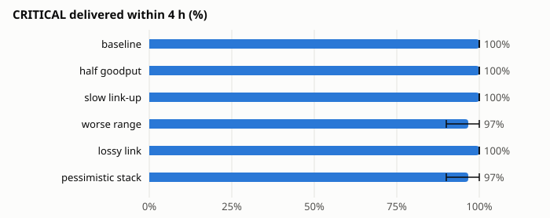
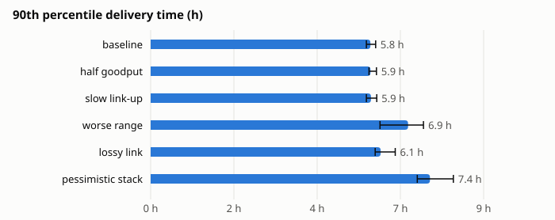

# Emulator-to-real sensitivity

> [!NOTE]
> **Emulated, and deliberately pessimistic.** The [Arusha sizing run](arusha.md) uses our
> best-estimate radio figures. This companion asks the opposite question: if the real hardware
> performs **worse** than modelled, do the two promises — no silent loss, and critical referrals
> inside 4 hours — still hold? Each variant pushes one emulator→real unknown to a pessimistic
> value; the last pushes all of them at once. Nothing here is a performance claim; it bounds the
> downside until the H1 bench measures the real values.

## What it says

- **No silent loss held in every variant: 0 invariant violations across all 60 runs**, including
  the all-pessimistic stack. Delivery slows under worse radio, but nothing disappears unflagged —
  the property the design exists to guarantee is the one that did not bend.
- **Critical referrals stayed inside 4 hours almost everywhere.** Critical-within-4h is 100 % at
  baseline and 97 % (90–100) even in the pessimistic stack. What degrades is the *2-hour* figure:
  100 % at baseline, 67 % (53–80) in the stack. Under worse-than-modelled radio, nearly all
  critical referrals still arrive within four hours, but the comfortable two-hour margin is spent.
- **Slow link-up and halved goodput, on their own, changed almost nothing.** A 3 s join time
  (versus 1.5 s assumed) eating into a 3–7 s drive-by, and Wi-Fi goodput cut to a quarter of the
  PHY rate, each left delivery and timing inside the baseline intervals. At these message volumes
  the network is still limited by *when vehicles meet*, not by how fast a contact transfers — the
  contact windows have slack to spare.
- **Radio range is again the dominant factor.** The worse-range variant alone dropped delivery
  within 4 h from 81 % to 71 %, pushed p90 from 5.8 h to 6.9 h, and was the only single change to
  move critical-within-4h off 100 %. This echoes the Arusha study: measuring real range in H1 and
  mounting antennas well is worth more than any amount of extra relay nodes.
- **The floor case (everything pessimistic at once):** overall delivery within the day falls from
  85 % to 76 %, all-messages-within-4h from 81 % to 62 %, median time rises from 1.7 h to 2.7 h and
  p90 from 5.8 h to 7.4 h. A real deployment at the worse end of every assumption still delivers
  three-quarters of messages the same day and loses none silently.
- **Power and storage were never the constraint.** Lowest battery stayed at 94 % and peak storage
  stayed inside a few MB of a 32 GB card in every variant. Relative overhead rose to about 61 bytes
  moved per byte delivered in the stack, as fewer, poorer contacts carry the same fixed signed
  summaries and receipts.

## Caveats

- Same model and volumes as the [Arusha sizing run](arusha.md): 93 messages a day across four
  clinics, three critical; ten seeds, each one simulated Friday in January. Weekly and seasonal
  effects are not swept here.
- The pessimistic values are *plausible* worse cases, not measurements. H1 replaces them with real
  link-up time, goodput and range; the point of this sweep is to show the direction and rough
  magnitude of the risk, not its exact size.
- Critical-message figures rest on three referrals a day (30 per variant), so their intervals are
  wide — read the 2-hour degradation as a trend, not a precise number.

## Reproduce

```bash
uv run python -m simulation.batch --sweep simulation/sweeps/sensitivity.yaml
uv run python -m simulation.report out/batch/sensitivity --scenario arusha --title "Emulator-to-real sensitivity"
```





### Delivery

| Variant | Delivered % | CRITICAL ≤ 2 h % | CRITICAL ≤ 4 h % | CRITICAL ≤ 6 h % | All ≤ 4 h % | p50 (h) | p90 (h) |
|---|---|---|---|---|---|---|---|
| baseline | 85 (84–87) | 100 (100–100) | 100 (100–100) | 100 (100–100) | 81 (80–82) | 1.7 (1.6–1.7) | 5.8 (5.7–6.0) |
| half goodput | 86 (84–87) | 97 (90–100) | 100 (100–100) | 100 (100–100) | 80 (78–82) | 1.7 (1.6–1.7) | 5.9 (5.8–6.0) |
| slow link-up | 86 (85–87) | 100 (100–100) | 100 (100–100) | 100 (100–100) | 81 (80–82) | 1.7 (1.6–1.8) | 5.9 (5.7–6.0) |
| worse range | 82 (79–85) | 90 (77–100) | 97 (90–100) | 97 (90–100) | 71 (68–74) | 2.1 (2.0–2.3) | 6.9 (6.1–7.3) |
| lossy link | 81 (79–83) | 100 (100–100) | 100 (100–100) | 100 (100–100) | 76 (75–78) | 1.9 (1.9–1.9) | 6.1 (6.0–6.5) |
| pessimistic stack | 76 (72–80) | 67 (53–80) | 97 (90–100) | 97 (90–100) | 62 (56–67) | 2.7 (2.4–3.2) | 7.4 (7.1–8.1) |

### Resources

| Variant | Peak storage, vehicle (MB) | Peak storage, relay (MB) | Lowest battery (%) | Busiest node (% of time) | Bytes moved per byte delivered |
|---|---|---|---|---|---|
| baseline | 1.70 (1.70–1.70) | 1.67 (1.67–1.67) | 94 (94–94) | 0.04 (0.04–0.04) | 46 (44–48) |
| half goodput | 1.73 (1.70–1.73) | 1.69 (1.67–1.69) | 94 (94–94) | 0.04 (0.04–0.04) | 49 (46–51) |
| slow link-up | 1.74 (1.70–1.74) | 1.73 (1.67–1.73) | 94 (94–94) | 0.04 (0.04–0.04) | 46 (43–49) |
| worse range | 1.75 (1.72–1.75) | 1.74 (1.71–1.74) | 94 (94–94) | 0.05 (0.04–0.05) | 51 (48–55) |
| lossy link | 1.69 (1.67–1.69) | 1.68 (1.66–1.68) | 94 (94–94) | 0.04 (0.04–0.04) | 49 (44–54) |
| pessimistic stack | 3.20 (1.72–3.20) | 1.72 (1.69–1.72) | 94 (94–94) | 0.04 (0.04–0.04) | 61 (49–80) |

### Variants

Every value is a key in `simulation/assumptions.yaml`; a variant overrides only the keys shown.

| Variant | Override | Meaning |
|---|---|---|
| half goodput | `radio.wifi_goodput_fraction: 0.25` | real Wi-Fi often reaches ~half the PHY rate; this halves that again |
| slow link-up | `radio.wifi_join_s: 3.0` | 3 s to bring the link up, against a 3–7 s drive-by contact |
| worse range | `radio.wifi_ple: 3.4` | path-loss exponent 3.4 (~60 m instead of ~90 m) |
| lossy link | `radio.p_good_to_bad: 0.1`, `radio.bit_flip_per_frame: 0.001` | links drop to the bad state and frames flip bits |
| pessimistic stack | all of the above | the floor a pilot should plan against |
